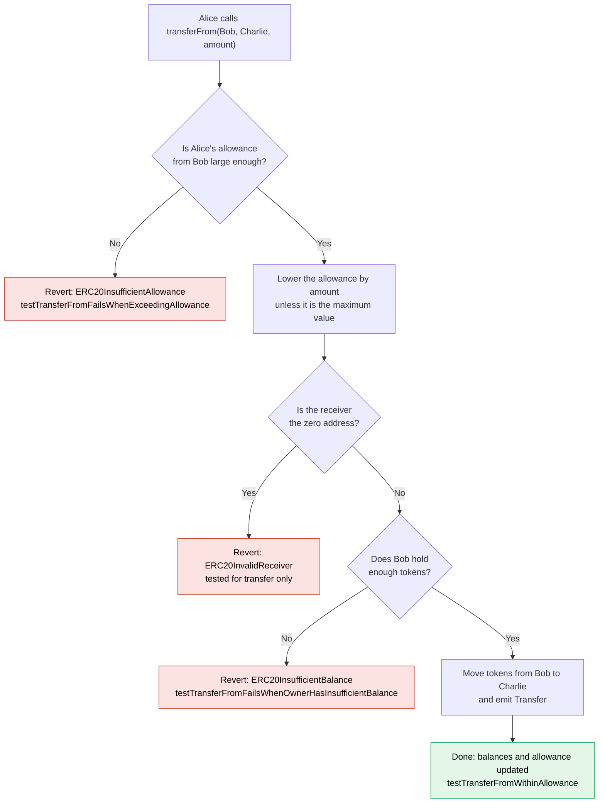

# 🪙 Foundry ERC-20 Token (`OurToken` and `ManualToken`)


A fixed-supply ERC-20 token built on OpenZeppelin and tested with Foundry, plus a from-scratch `ManualToken` that shows what the ERC-20 standard really asks for and what a bare-bones version leaves out.

- **Developer and write-ups:** Yuvraj Singh
- **Course:** Built alongside Patrick Collins' Cyfrin Updraft Advanced Foundry course (ERC-20 section). The contracts follow the course design. The notes and the Known Limitations section are my own, written while studying it.
- **Stack:** Solidity `0.8.20` | Foundry (`forge`, `anvil`, `cast`) | OpenZeppelin Contracts `v5.0.2`

---

## 📑 Contents

1. [Overview](#-1-overview)
2. [Quickstart](#-2-quickstart)
3. [Tests](#-3-tests)
4. [Design choices](#-4-design-choices)
5. [Known limitations](#-5-known-limitations)
6. [Study notes](#-6-study-notes)
   - [6.1 What ERC-20 requires](#-61-what-erc-20-requires)
   - [6.2 How allowances work](#-62-how-allowances-work)
   - [6.3 Walkthrough of `ManualToken`](#-63-walkthrough-of-manualtoken)
7. [License and acknowledgements](#-7-license-and-acknowledgements)

---

## 🎯 1. Overview

| Contract | What it is |
| :--- | :--- |
| **`OurToken`** | A complete ERC-20 token built on OpenZeppelin v5.0.2. Name `OurToken`, symbol `OT`, 18 decimals. The whole initial supply is minted to the deployer in the constructor, and there is no mint function afterwards. The deploy script creates it with `1000 ether` (1,000 tokens). |
| **`ManualToken`** | A minimal token written from scratch to learn what the standard is made of. It is deliberately incomplete. See [Known limitations](#-5-known-limitations) for exactly what is missing. |

### How an allowance transfer works

This is the flow tested in `testTransferFromWithinAllowance`: Bob lets Alice spend some of his tokens, and Alice sends part of them to Charlie.



### What `OurToken` exposes

| Function | Purpose |
| :--- | :--- |
| `name()`, `symbol()`, `decimals()` | Token metadata (`OurToken`, `OT`, `18`). |
| `totalSupply()` | Total tokens in existence. |
| `balanceOf(account)` | Tokens held by an address. |
| `transfer(to, amount)` | Send your own tokens. |
| `approve(spender, amount)` | Let another address spend up to `amount` of your tokens. |
| `allowance(owner, spender)` | How much a spender is still allowed to spend. |
| `transferFrom(from, to, amount)` | Spend tokens on behalf of an owner, within the allowance. |

Events: `Transfer` and `Approval`. Failures use OpenZeppelin v5 custom errors such as `ERC20InsufficientBalance`, `ERC20InsufficientAllowance` and `ERC20InvalidReceiver`.

---

## 🚀 2. Quickstart

### 📂 Project structure

```text
Foundry-ERC_20/
├── .github/workflows/        # GitHub Actions workflow
├── lib/                      # Dependencies (OpenZeppelin v5.0.2, forge-std)
├── src/
│   ├── OurToken.sol          # ERC-20 built on OpenZeppelin
│   └── ManualToken.sol       # Minimal from-scratch token (learning version)
├── script/
│   └── DeployOurToken.s.sol  # Deploys OurToken with 1000 tokens of supply
├── test/
│   └── OurTokenTest.t.sol    # 11 tests: metadata, transfers, allowances
├── Makefile                  # Build, test, anvil and deploy shortcuts
├── foundry.toml              # Foundry config and OpenZeppelin remapping
└── foundry.lock
```

### 🔨 Install and build

```bash
git clone --recurse-submodules https://github.com/Yuvi8990/Foundry-ERC_20.git
cd Foundry-ERC_20
forge build
```

If `lib/` comes out empty, run `make install` to fetch the dependencies, then build again.

### 🧪 Run the tests

```bash
# All tests
forge test

# Verbose output
forge test -vvv

# One test with full traces
forge test --mt testTransferFromWithinAllowance -vvvv

# Per-function gas, snapshot and coverage
forge test --gas-report
forge snapshot
forge coverage
```

### 🌐 Deploy locally

```bash
# Terminal 1: start a local Anvil node
make anvil

# Terminal 2: deploy to it
make deploy
```

`make deploy` signs with Anvil's default account #0. That key is public and only meant for local use.

### 🚀 Deploy to Sepolia

The Sepolia target signs with a Foundry keystore account instead of a raw private key. Import your key once, and keep it out of the repo:

```bash
cast wallet import sepolia-deployer --interactive
```

Create a `.env` file (never commit it):

```bash
SEPOLIA_RPC_URL=https://your-sepolia-rpc-url
ACCOUNT=sepolia-deployer
SENDER=0xYourDeployerAddress
ETHERSCAN_API_KEY=your-etherscan-key
```

Then deploy and verify:

```bash
make deploy-sepolia
```

### 🎟️ Interact with a deployed token

```bash
# Check a balance
cast call <TOKEN_ADDRESS> "balanceOf(address)(uint256)" <ADDRESS> --rpc-url $SEPOLIA_RPC_URL

# Send 1 token
cast send <TOKEN_ADDRESS> "transfer(address,uint256)" <RECIPIENT> $(cast to-wei 1) --account sepolia-deployer --rpc-url $SEPOLIA_RPC_URL
```

---

## 🧪 3. Tests

All 11 tests live in `test/OurTokenTest.t.sol`.

| Test | What it verifies |
| :--- | :--- |
| `testInitialSupply` | `totalSupply()` equals the `INITIAL_SUPPLY` set in the deploy script. |
| `testUsersCantMint` | Calling `mint` on the token reverts, because the token exposes no mint function. |
| `testBobBalance` | After setup, Bob holds `STARTING_BALANCE` (100 tokens). |
| `testTokenMetadata` | Name is `OurToken`, symbol is `OT`, decimals are `18`. |
| `testDirectTransferUpdatesBalances` | Bob sends 20 tokens to Alice. The call returns `true`, and both balances update correctly. |
| `testTransferFailsWhenExceedingBalance` | Sending one unit more than the balance reverts. |
| `testTransferToZeroAddressReverts` | Transferring to `address(0)` reverts. |
| `testApproveSetsAllowance` | `approve` records the allowance, readable through `allowance`. |
| `testTransferFromWithinAllowance` | Alice moves 400 of Bob's tokens to Charlie. Balances update and the remaining allowance is 600. |
| `testTransferFromFailsWhenExceedingAllowance` | With an allowance of 500, a `transferFrom` of 600 reverts. |
| `testTransferFromFailsWhenOwnerHasInsufficientBalance` | An allowance larger than Bob's balance still cannot move more than he holds. |

**Cheatcodes and helpers used:** `makeAddr` to create labelled test accounts, `vm.prank` to act as a specific caller, `vm.expectRevert` to assert failures, and `assertEq` and `assertTrue` for the checks.

---

## 🧠 4. Design choices

| Choice | Why |
| :--- | :--- |
| **Build on OpenZeppelin v5.0.2** | The standard behaviour (balances, allowances, events, errors) comes from a widely reviewed library, so this repo only adds a name, a symbol and the initial mint. |
| **Fixed supply, minted once in the constructor** | There is no function to create tokens later, so the supply cannot be inflated. The trade-off is that the deployer starts with 100 percent of it. |
| **Custom errors from OpenZeppelin v5** | Cheaper than revert strings, and each failure says exactly what went wrong. |
| **The deploy script returns the token** | The tests run the same script as a real deployment, so they exercise the real deployment path. |
| **Keystore-based Sepolia deploy** | `make deploy-sepolia` uses `--account`, so no raw private key appears in a command or a file. |
| **`@openzeppelin` remapping in `foundry.toml`** | Imports read `@openzeppelin/contracts/...` and resolve to `lib/openzeppelin-contracts`. |

---

## 🚨 5. Known limitations

**`ManualToken` (learning version)**

1. **It is not a complete ERC-20.** It has no `approve`, `allowance` or `transferFrom`, emits no `Transfer` or `Approval` events, has no `symbol`, and `transfer` returns nothing where the standard requires a `bool`. Wallets, exchanges and other contracts could not integrate it.
2. **No tokens exist.** `totalSupply()` returns a constant `100 ether`, but nothing ever mints, so every balance is zero. Any `transfer` of a positive amount reverts on underflow.
   *Fix:* mint in a constructor and keep the supply in a state variable.
3. **The sum check in `transfer` can never fail.** `require(balanceOf(msg.sender) + balanceOf(_to) == previousBalances)` restates an invariant that holds by construction, and Solidity 0.8 already reverts on overflow and underflow. It documents the intent but catches nothing.
4. **It has no tests.** The test suite covers `OurToken` only.

**`OurToken`**

5. **The deployer holds the entire supply at the start.** Fine for a learning token, but a real token would distribute it or mint to a multisig.
6. **Changing an allowance has a known race condition.** If Bob changes Alice's allowance from one non-zero value to another, Alice can front-run the change and spend both amounts. OpenZeppelin v5 no longer ships `increaseAllowance` and `decreaseAllowance`, so the usual advice is to set the allowance to zero first, or to add ERC-20 `permit`, which this token does not implement.
7. **Tokens sent to the token's own address are lost.** There is no rescue function.

**Test gaps**

8. **Reverts are not checked precisely.** Most failure tests use a bare `vm.expectRevert()`, which proves something reverted but not why. OpenZeppelin v5 gives specific errors, so the tests could assert on those.
9. **Missing cases:** `Transfer` and `Approval` event checks, fuzz tests for balances and allowances, and the infinite-allowance case, where an allowance of `type(uint256).max` is not reduced by `transferFrom`.

---

## 📚 6. Study notes

These sections explain the reasoning behind the code. They are my notes from working through it.

### 📜 6.1 What ERC-20 requires

ERC-20 is a standard interface. If a contract implements it, wallets, exchanges and other contracts can treat it like any other token without knowing its internals.

- **Required functions:** `totalSupply`, `balanceOf`, `transfer`, `transferFrom`, `approve`, `allowance`.
- **Required events:** `Transfer` and `Approval`. Minting is reported as a `Transfer` from `address(0)`, which is how explorers know where new tokens came from.
- **Conventional metadata:** `name`, `symbol` and `decimals`. They are optional in the standard, but every real token has them.

With `decimals` set to 18, one token is `10^18` smallest units. In Solidity, `1000 ether` is just `1000 * 10^18`. The `ether` suffix is a unit multiplier and has nothing to do with ETH here, which is why it is used to write 1,000 tokens.

### 🤝 6.2 How allowances work

Some actions need a contract to move tokens for you, such as a swap on an exchange. Instead of handing over your tokens, you call `approve(spender, amount)`, which records how much that spender may take. Later, the spender calls `transferFrom(owner, to, amount)`, and the token checks two things: the owner has enough balance, and the spender's allowance covers the amount. Each successful call lowers the allowance by the amount spent. The tests cover a normal use (`testTransferFromWithinAllowance`) and both failure cases: too little allowance and too little balance.

### 🛠️ 6.3 Walkthrough of `ManualToken`

```solidity
function transfer(address _to, uint256 _amount) public {
    uint256 previousBalances = balanceOf(msg.sender) + balanceOf(_to);
    s_balances[msg.sender] -= _amount;
    s_balances[_to] += _amount;
    require(balanceOf(msg.sender) + balanceOf(_to) == previousBalances);
}
```

- **`s_balances`** is a private mapping from address to balance, read through `balanceOf`.
- **`name`, `totalSupply` and `decimals`** are `pure` because they return constants and read no storage.
- **`transfer`** subtracts from the sender and adds to the recipient. If the sender's balance is too small, the subtraction reverts, because Solidity 0.8 checks arithmetic automatically.
- **The `require` at the end** states that tokens are only moved, never created or destroyed. It is a useful thing to write down, but as noted in the limitations, it cannot fail in this version.

Writing this by hand made it clear how much work the standard and OpenZeppelin do: allowances, events, return values, zero-address checks and clear errors are all things this version skips.

---

## 📜 7. License and acknowledgements

* **License:** MIT
* **Acknowledgements:** Thanks to Patrick Collins and the Cyfrin Updraft team for the Advanced Foundry course this project follows, and to OpenZeppelin for the contracts library.
